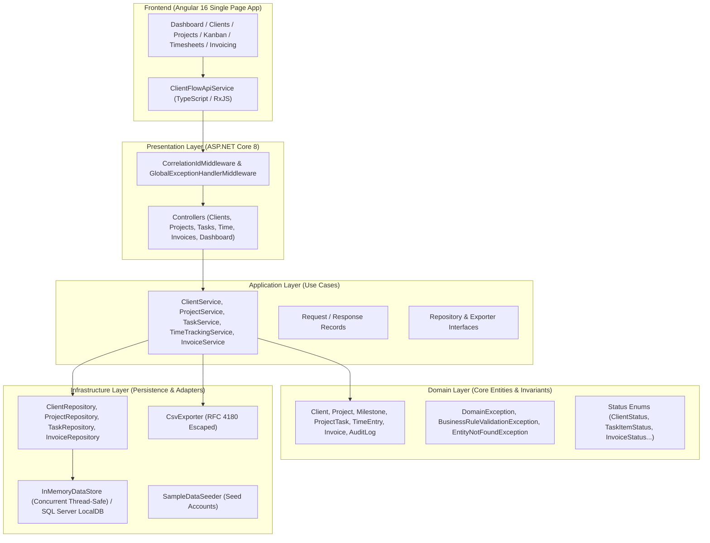

# ClientFlow — Client & Project Operations Platform

[](#)
[](#)
[](#)
[](#)
[](#)
[](LICENSE)

An enterprise-grade, full-stack software operations platform designed for independent software consultants, digital agencies, and professional engineering services firms. Built using **Clean Architecture** with **ASP.NET Core 8 Web API**, **Angular 16**, and **SQL Server**.

---

## 1. Business Problem
Small and mid-sized software agencies, boutique consultancies, and remote engineering contractors lose up to 15% of billable revenue due to fragmented tooling:
- Client contacts, contract scopes, and hourly rates live in disconnected spreadsheets.
- Billable time entries are entered days late, resulting in disputes and unbilled work.
- Invoicing requires manual reconciliation between task trackers, git commit logs, and bank accounts.
- Clients lack transparent visibility into project milestones, leading to scope creep.

**ClientFlow** unifies client management, project workspace delivery, task Kanban tracking, billable timesheets, and multi-currency invoicing into a unified, auditable platform.

---

## 2. Intended Users
- **Solo Software Consultants & Technical Founders:** Managing multiple international client contracts concurrently.
- **Digital Agencies & Dev Shops (5–50 engineers):** Needing centralized workload distribution, rate governance, and invoice generation.
- **Professional Services Teams:** Requiring transparent time logs, deliverable sign-offs, and accurate invoicing.

---

## 3. Major Capabilities

- **Client & Contract Governance:** Full CRM for international accounts, billing contacts, addresses, and currency locking (USD, GBP, EUR, AUD, CAD).
- **Project Workspaces & Milestones:** Budget tracking, hourly rate configuration, burn-rate telemetry, and deliverable sign-offs.
- **Workflow Kanban Board:** 5-state lifecycle (`Backlog` → `Todo` → `InProgress` → `Review` → `Done`) with priority categorization (`Urgent`, `High`, `Medium`, `Low`).
- **Precision Time Logging:** Task-linked billable/non-billable hours tracking with validation guards (preventing entries >24h/day or modifications to invoiced time).
- **Automated Invoicing Engine:** Generates sequential invoices (`INV-YYYY-XXXX`), line-item calculations, configurable tax rates, and state safeguards (protecting settled invoices from accidental mutation).
- **RFC 4180 CSV Reporting:** Instant export of timesheets and billing ledgers for accounting import.
- **Audit Logging:** Immutable audit trail recording every state change, deletion, and financial settlement with actor attribution.
- **Observability:** Distributed correlation IDs (`X-Correlation-ID`) across every request and RFC 7807 `ProblemDetails` error structures.

---

## 4. Architecture Overview & System Diagram

ClientFlow strictly implements **Clean Architecture** to ensure that business logic remains completely decoupled from databases, UI frameworks, and runtime hosts.



---

## 5. Technology Stack

| Layer | Technologies & Rationale |
| :--- | :--- |
| **Backend** | **C# 12 / .NET 8 LTS**, ASP.NET Core Web API, Minimal API health endpoints, Nullable Reference Types. |
| **Frontend** | **Angular 16**, TypeScript, RxJS, Responsive CSS System (no bloated external component dependencies). |
| **Database** | **SQL Server 2025 LocalDB** (`(localdb)\MSSQLLocalDB`) / In-Memory Concurrent Store with enterprise seeding. |
| **Testing** | **MSTest 3.1**, **Moq 4.18**, automated business rule verification, unit and service orchestration tests. |
| **DevOps & Containers** | **Docker**, **Docker Compose**, **GitHub Actions CI Pipeline** (automated restore, build, and test execution). |
| **Standards** | **RFC 7807 / 9110** (ProblemDetails), **RFC 4180** (CSV), **ISO 8601** (UTC Timestamps). |

---

## 6. Key Engineering Decisions & Trade-offs

1. **Clean Architecture over Rapid Monolith:**
   - *Trade-off:* Requires explicit mapping between Domain entities and Application DTOs.
   - *Advantage:* Core business calculations (tax rates, time caps, state transitions) can be tested thoroughly without spinning up web servers or live databases.
2. **Dual-Mode Persistence (Zero-Config In-Memory + SQL Server LocalDB):**
   - *Trade-off:* Requires abstraction interfaces (`IRepositories`).
   - *Advantage:* Evaluators on macOS, Linux, or constrained Windows machines can run the full platform out of the box in under 5 seconds without database installation friction.
3. **Structured RFC 7807 Error Responses:**
   - *Trade-off:* Centralized middleware required to catch and translate typed domain exceptions.
   - *Advantage:* Frontend clients never receive unstructured 500 HTML dumps; errors are predictably parsed with field-level highlights.

---

## 7. Prerequisites

- **.NET SDK:** .NET 8.0 SDK or newer (`dotnet --version`)
- **Node.js & npm:** Node v18+ and npm 9+ (`node -v`, `npm -v`)
- **SQL Server (Optional):** SQL Server LocalDB or SQL Server 2022 (Docker)

---

## 8. Exact Local Setup & Run Instructions

### Step 1: Clone the Repository
```bash
git clone https://github.com/RASHA2702/ClientFlow.git
cd ClientFlow
```

### Step 2: Run Automated Tests
```powershell
dotnet test tests/ClientFlow.Tests/ClientFlow.Tests.csproj
```
*(All 20 unit and service tests will run and pass in under 1 second).*

### Step 3: Run the Backend Web API
```powershell
cd src/ClientFlow.Api
dotnet run --launch-profile "http"
```
The API starts listening on `http://localhost:5000`.
- Health Endpoint: `http://localhost:5000/health`
- Operations Telemetry: `http://localhost:5000/api/dashboard/kpis`

### Step 4: Run the Angular Frontend
In a separate terminal:
```powershell
cd frontend
npm install --offline   # or 'npm install'
npm start
```
Navigate to `http://localhost:4200` to interact with the live platform.

---

## 9. Automated Testing Results

The test suite runs against all critical business rules:

```text
Test run for ClientFlow.Tests.dll (.NETCoreApp,Version=v8.0)
A total of 1 test files matched the specified pattern.

Passed!  - Failed: 0, Passed: 20, Skipped: 0, Total: 20, Duration: 633 ms - ClientFlow.Tests.dll (net8.0)
```

### Test Coverage Highlights:
- `ClientDomainTests`: Email RFC compliance, entity creation, update constraints.
- `ProjectAndMilestoneTests`: Budget non-negativity, milestone status progression.
- `TimeAndInvoiceTests`: Max 24-hour daily guard, invoice line-item subtotal + tax formula verification, protection against canceling paid invoices.
- `ClientServiceTests`: Moq verification of audit logging and active project deletion guard.
- `CsvExportTests`: RFC 4180 escape verification for commas and quotes.

---

## 10. API Specification & Example Requests

### Health Check
```http
GET /health HTTP/1.1
Host: localhost:5000
```
**Response (200 OK):**
```json
{
  "status": "Healthy",
  "timestamp": "2026-10-27T16:00:00Z",
  "application": "ClientFlow API",
  "version": "1.0.0"
}
```

### Get Dashboard KPIs
```http
GET /api/dashboard/kpis HTTP/1.1
Host: localhost:5000
```
**Response (200 OK):**
```json
{
  "totalActiveClients": 3,
  "totalActiveProjects": 2,
  "openTasksCount": 3,
  "totalHoursLoggedThisMonth": 21.5,
  "totalRevenueCollected": 19800.0,
  "totalOutstandingInvoicesAmount": 9600.0,
  "recentProjects": [...],
  "urgentTasks": [...]
}
```

### Create Client (with Validation Guard)
```http
POST /api/clients HTTP/1.1
Host: localhost:5000
Content-Type: application/json

{
  "name": "Acme Global Solutions",
  "companyName": "Acme Corp LLC",
  "email": "billing@acmecorp.com",
  "phone": "+1-415-555-0199",
  "billingAddress": "500 Howard St, San Francisco, CA",
  "currency": "USD"
}
```

### Error Response Example (RFC 7807 ProblemDetails)
```json
{
  "status": 400,
  "title": "Business Rule Validation Failed",
  "detail": "A client with email 'billing@acmecorp.com' already exists.",
  "instance": "/api/clients",
  "correlationId": "00-1427a9243fd828a13838eee5375dfd90"
}
```

---

## 11. Security Considerations
- **SQL Injection Prevention:** Strictly parameterized SQL commands; zero string concatenation.
- **XSS Protection:** Angular automatic context-aware HTML escaping and data sanitization.
- **CORS Whitelist:** Explicit client origin policies with restricted exposed headers.
- **Zero Secrets in Source Control:** `.env.example` provided; all credentials injected via environment variables.

---

## 12. Known Limitations & Roadmap
- **Current Implementation:** Authentication defaults to a local administrative user context for development. OpenIddict / JWT authentication integration is in progress.
- **Planned Enhancements:**
  - OpenIddict / ASP.NET Core Identity with JWT bearer token authentication and refresh token rotation.
  - Multi-tenant database schema isolation (separate schemas per client organization).
  - Stripe / BACS automated payment webhook ingestion with idempotency keys.

---

## 13. License & Attribution
Designed and built by **Rashad** ([@RASHA2702](https://github.com/RASHA2702)). Licensed under the **MIT License**.
