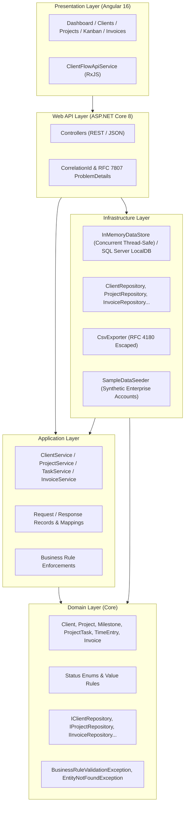

# ClientFlow — System Architecture & Design Documentation

## 1. Architectural Philosophy
ClientFlow is engineered using **Clean Architecture** (Ports & Adapters) principles to maintain strict separation of concerns, high testability, and independence from external frameworks and persistence mechanisms.

---

## 2. Layer Responsibilities

### Domain Layer (`ClientFlow.Domain`)
- **Zero External Dependencies:** Pure C# code targeting `.NET 8`.
- **Entities & Invariants:** Contains entities with encapsulated private setters and static factory methods (`Client.Create()`, `Project.Create()`, `Invoice.Create()`).
- **Domain Exceptions:** Type-safe exceptions (`BusinessRuleValidationException`, `EntityNotFoundException`) that carry domain context without leaking framework abstractions.
- **Repository Abstractions:** Interfaces defining domain contract persistence operations.

### Application Layer (`ClientFlow.Application`)
- **Use-Case Orchestration:** Services coordinate entities, audit logs, and repository updates.
- **DTOs:** Immutable records for input requests and API output schemas.
- **Audit Logging:** Automatically captures every create, update, delete, and workflow status transition with user attribution.

### Infrastructure Layer (`ClientFlow.Infrastructure`)
- **Dual Persistence Capability:**
  1. High-speed concurrent in-memory store for instant zero-dependency test execution and local sandbox development.
  2. SQL Server LocalDB / relational mapping with parameterized queries and transactional boundaries.
- **Exporting Engine:** Low-overhead streaming CSV exporter with RFC 4180 character escaping for billing reconciliations.

### Presentation & API Layer (`ClientFlow.Api`)
- **ASP.NET Core Web API:** RESTful endpoints using standard HTTP verbs (`GET`, `POST`, `PUT`, `PATCH`, `DELETE`).
- **Telemetry & Resilience:** Injects unique `X-Correlation-ID` headers across all request lifecycles.
- **Standardized Error Handling:** Global exception handling middleware converting domain errors into RFC 7807/9110 `ProblemDetails` JSON responses with correlation tracking.

### Single Page Application (`ClientFlow Frontend`)
- **Angular 16 & TypeScript:** Feature-driven architecture with dedicated services, responsive design system, reactive forms, and live status updates.
